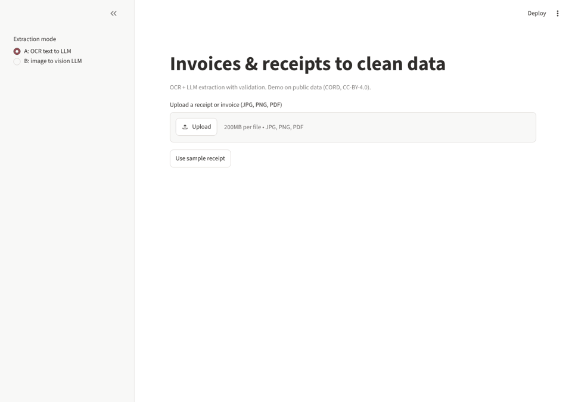
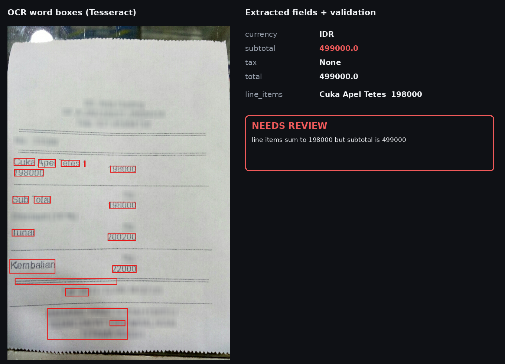
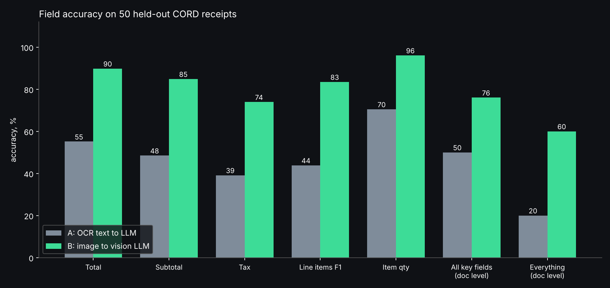

# doc-extract

Turn invoices and receipts into validated, structured data with OCR + LLMs.



## The problem

Typing data from receipts and invoices into a system is slow, and plain OCR output is messy text with no structure and no sanity checks. This repo turns a photo or PDF into a strict JSON record, checks that the numbers add up, and flags the documents a human should look at.

## How it works

```
PDF / image
  -> pre-processing   PDF to image (multipage), deskew, optional denoise
  -> OCR              Tesseract, word boxes kept (drawn in the UI)
  -> LLM extraction   strict Pydantic schema, JSON retries on invalid output
        mode A: OCR text -> LLM        mode B: image -> vision LLM
  -> validation       line items vs subtotal, subtotal + tax + service - discount vs total,
                      qty x unit price vs amount, date parses, ISO currency
  -> confidence + "needs review" flag with reasons
  -> export           JSON, CSV, optional append to a Google Sheet
```

- `docextract/` is the package: `preprocess.py`, `ocr.py`, `extract.py` (prompt, schema, retries), `validate.py`, `export.py`, `llm.py`.
- `api/app.py`: FastAPI, `POST /extract` (file upload, `?mode=text|vision`, `?format=json|csv`).
- `ui/app.py`: Streamlit, image with OCR boxes on the left, fields on the right, failing fields marked, CSV and JSON download.
- `eval/run_eval.py`: field-level accuracy, mode A vs B.
- The LLM backend is chosen with env vars (`LLM_PROVIDER=openrouter|anthropic|openai`, `LLM_MODEL`). The eval below ran through OpenRouter.



The receipt above is a real eval case: the model read the cash tendered line as the subtotal (499000), the line items add up to 198000, and the validator flags it for review instead of letting a wrong number through.

## Results

Data: 50 receipts drawn with a fixed seed (42) from the CORD v2 test split. They were never used while writing prompts or choosing thresholds; those were tuned on a handful of receipts from the validation split. Model: `anthropic/claude-haiku-4.5` via OpenRouter for both modes, Tesseract 5 for OCR. Everything here is copied from [`eval/results.md`](eval/results.md), produced by `python -m eval.run_eval` (per-document rows in `eval/results.csv`).

| Metric | A: OCR text to LLM | B: image to vision LLM |
|---|---|---|
| Total amount correct | 55% | 90% |
| Subtotal correct (33 receipts that have one) | 48% | 85% |
| Tax correct (23 receipts that have one) | 39% | 74% |
| Line items F1 (amount + description match) | 44% | 83% |
| Item quantity correct (matched items) | 70% | 96% |
| Receipts with total, subtotal and tax all correct | 50% | 76% |
| Receipts with everything correct incl. all line items | 20% | 60% |
| Flagged for review | 68% | 26% |
| Auto-approved receipts with total, subtotal and tax all correct | 88% | 95% |
| Median latency per receipt | 2.6 s | 2.9 s |
| LLM cost per 100 receipts | US$0.15 | US$0.24 |



What this says, honestly:

- Vision beats OCR-then-LLM by a wide margin here, mostly because CORD is phone photos of crumpled thermal receipts and Tesseract reads them badly (16 of 50 receipts yielded no usable total in mode A). On clean scans or digital PDFs, mode A is much closer and cheaper; this eval does not measure that.
- Validation earns its keep. Mode B had 5 wrong totals and validation flagged 4; mode A had 22 wrong or missing totals and flagged 20 (16 of those were "no total found"; of the 6 wrong values, 4 were flagged). It also raises false alarms: it flagged 9 of 45 receipts in B whose total was right, because CORD receipts carry discounts, rounding and service charges that the rules only partly model. Examples are listed in `eval/results.md`, for instance a receipt where the model returned a total of 100000 against a true 60500, caught because the line items summed to 155000 against a subtotal of 95000.
- Cost is the amount OpenRouter reported per call. Latency is the median wall-clock time per receipt (OCR plus LLM for mode A). Means are not reported because the first full run hit transient OpenRouter credit errors that triggered backoff retries.
- Results vary a little between runs and machines: OCR output and LLM replies are not bit-for-bit repeatable, so a re-run of the same receipt can differ from the cached eval.
- 50 receipts is a small sample, so a few points of difference are noise.

### What is scored

CORD annotates menu items, subtotal, tax and total. So the eval scores `total`, `subtotal`, `tax` and line items (`description`, `qty`, `amount`). **Not scored** because CORD has no ground truth for them: `vendor_name`, `vendor_address`, `date`, `invoice_number`, `currency`, `unit_price`, `discount`, `service_charge`. They are still in the schema and extracted. Amounts are compared numerically after normalising CORD's separators (`60.000` and `60,000` both mean 60000). Descriptions are compared exactly and after lower-casing and removing punctuation. A line item counts as correct when its amount is equal and its description is at least 60% similar (difflib ratio). Subtotal and tax are scored only on receipts that have them.

## Adapt it to your documents

- New document type: edit the Pydantic models in `docextract/schema.py`, the field list in the prompt in `docextract/extract.py`, and the rules in `docextract/validate.py`. Purchase orders, delivery notes, forms and bank statements are the same pipeline with a different schema and different checks.
- Export: CSV and JSON are built in. `export.append_to_sheet` appends rows to a Google Sheet through a service account (untested here: no real sheet was available). The same hook is the place for an ERP, CRM or database insert.
- Sensitive documents: nothing is stored. Point `LLM_PROVIDER` at a model you host (any OpenAI-compatible endpoint) and run the containers on your own infrastructure, including EU or on-premise hosting.

## Run it

```bash
bash scripts/download_data.sh      # CORD (only needed for the eval)
cp .env.example .env               # add OPENROUTER_API_KEY (or ANTHROPIC_API_KEY / OPENAI_API_KEY)
docker compose up --build          # UI on :8501, API on :8000
```

Open http://localhost:8501 and upload a receipt (or press "Use sample receipt"). API: `curl -F file=@receipt.jpg localhost:8000/extract`.

Without Docker (needs `tesseract-ocr` installed): `python -m venv .venv && .venv/bin/pip install -r requirements.txt`, then `streamlit run ui/app.py` and `uvicorn api.app:app`. Re-run the eval with `python -m eval.run_eval --mode both && python eval/report.py` (replies are cached in `eval/cache`).

`docker compose up --build` was tested: both containers started and served the UI, `/health` and `/extract`. The test machine's proxy needed an extra CA certificate during `pip install` inside the build, which is not part of the committed Dockerfile; a normal network does not need it.

## Data and licenses

- **CORD v2** (naver-clova-ix/cord-v2 on Hugging Face), CC-BY-4.0, by Naver CLOVA. Used for the eval and downloaded by `scripts/download_data.sh`; the dataset is not in this repo. `assets/sample_receipt.png` is one CORD test image, included under CC-BY-4.0 with this attribution.
- **SROIE** was left out: its license terms could not be confirmed as permitting this use, so only CORD is used.
- Code: MIT, see `LICENSE`. Dependencies (Tesseract: Apache-2.0; PyMuPDF is AGPL-3.0 or commercial, so if you ship this commercially, swap it for `pdf2image` or buy a license) are used as installed from PyPI/apt.

Need your documents automated? Hire me on Upwork: https://www.upwork.com/freelancers/~014d8e815fea10ea82
